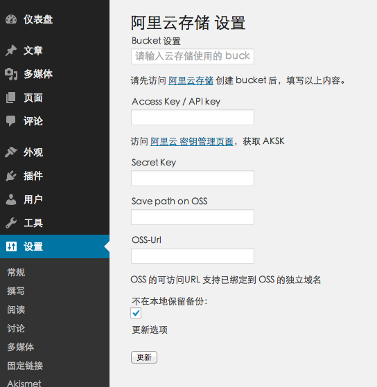

# 阿里云 OSS 支持插件 (Aliyun OSS For WordPress)

本插件主要为 Wordpress 提供基于阿里云 OSS 的远程附件存储功能，并且最大限度的依赖 Wordpress 本身功能扩展来实现，以保证插件停用或博客搬迁时可以快速切换回原来的方式。

## 插件特色

1. 支持 Aliyun OSS 的图片服务（根据参数获得不同尺寸的图片）
2. 自定义文件在 Bucket 上的存储位置  
3. 支持 Https 站点
4. 支持阿里云内网和 VPC 网络
6. 全格式附件支持，不仅仅是图片
7. 支持 WordPress 4.4+ 新功能 srcset，在不同分辨率设备上加载不同大小图片
8. 支持 WordPress 5.0+ 默认古藤堡编辑器Gutenburg
9. 支持阿里云url鉴权，实现高级别防盗链功能，支持阿里云CDN的A、B、C所有方式鉴权，推荐A方式
10. 支持在 WordPress 后台编辑图片
11. 支持预设图片样式，图片保护，自定义分割符
12. 中英文双语支持，方便使用英文为默认语言的同学
13. 支持在其他插件/主题中通过系统钩子调用插件功能
14. 代码遵循 PSR-4 规则编写

## 插件使用

关于插件使用方式的 Wiki: [Quick start](https://github.com/IvanChou/aliyun-oss-support/wiki/Quick-start)

### 下载

[latest release](../../releases/latest)

### 安装

将插件解压上传到 `/wp-content/plugins/` 或者通过 WordPress 插件中心上传安装

### 从旧版升级至 3.6.0

升级前请备份配置，并暂停附件上传和删除。

1. **停用插件，不要删除**，以保留原配置。
2. 上传新版 ZIP，选择替换当前版本。
3. 重新启用插件，进入设置页面验证权限。

本版本更换了 OSS SDK，请勿在旧插件启用时直接覆盖升级，以免发生错误。

### 配置

启用插件 `Aliyun OSS`

使用管理员账号进入「设置 → Aliyun OSS」完成相关设置（`/wp-admin/options-general.php?page=aliyun-oss`，需要 `manage_options` 权限）。

- 如果你使用的 ECS 与 OSS 在同一区域，可以开启『**内网/internal**』选项，节约流量
- 『Bucket 域名/Bucket Host』一项会自动补全，也可以手动设置为你的 **自定义域名** 或 CDN 域名



## 启用 OSS 图片服务

阿里云 OSS 提供了根据 url 参数来获得各种尺寸的 `阿里云OSS图片处理服务（Image Service，简称 IMG）`, 相比起 WordPress 上传的时候生成各种尺寸的图片, 这是一种更优雅的解决方案, 占用的存储空间更小, 尺寸变更更灵活。

如何开启并配置图片服务, 请参见: [How to use Image Service](https://github.com/IvanChou/aliyun-oss-support/wiki/How-to-use-Image-Service)

另外还有几点需要你了解:

1. 开启图片服务时, 只有原图会被上传到 OSS, 缩略图本地依旧会生成但不会上传
2. 基于第 1 条, 建议开启图片服务后就不要关了, 关掉会导致之前上传的图片缩略图无法访问（文章中的图片不受影响）
3. 基于第 2 条, 如果你确实想关掉图片服务，参见下一项里面的解决方案

## 启用 CDN URL鉴权

1.阿里云URL鉴权功能由CDN服务提供，安全级别比较高，启用URL鉴权功能时，需要先在阿里云CDN控制面板-域名管理-管理-访问控制中设置鉴权方式和鉴权主/备Key，Key为完全自定义，请勿使用您的密码/AK/SK，鉴权方式推荐设置为A方式。具体设置详见[什么是url防盗链](https://help.aliyun.com/document_detail/85117.html?spm=5176.11785003.domainDetail.2.1192142f7p1JWz)

2.在阿里云控制台中设置好鉴权方式和Key之后，打开插件URL鉴权功能，填入您的鉴权方式和Key，以及您希望URL失效的时间（按小时计），即可实现URL鉴权

3.如果不希望开启URL鉴权，阿里云CDN和OSS还带有更为简单的Refer黑/白名单防盗链功能，安全性稍差且不带链接失效时间设置，详见[CDN如何配置refer防盗链](https://help.aliyun.com/document_detail/27134.html?spm=5176.11785003.domainDetail.1.1192142f7p1JWz)[OSS防盗链使用指南](https://help.aliyun.com/document_detail/31869.html?spm=5176.8466029.referer.1.621714504i4WC3)

## 启用插件后，老文件无法访问

参见 WIKI：[How to handle old images](https://github.com/IvanChou/aliyun-oss-support/wiki/How-to-handle-old-images)

## 关于不在本地服务器上保留文件

『不在本地服务器上保留文件』建议不要开启, 理由如下:

1. 如果同时开启『图片服务』, 当你想停用这个插件的时候不可避免的会遇到缩略图丢失问题
2. 如果没有同时开启『图片服务』, 当你从后台删除图片或附件时, OSS 里面的缩略图无法被删掉

****

## 题外

本插架由官方商店中 马文建(@mawenjian) 同学的[「阿里云附件」](https://github.com/mawenjian/aliyun-oss-support)插件拓展而来。由于马同学在曾经的某段时间里没能即时维护这个项目，也没有开源，于是我在修复 bug 并 rebuild 后，将这个野生的修订版发布到阿里云社区，意外获得了 ACE 社区官方管理组的推荐。

后来，马同学 release 了 2.0 版本并开源他的项目了，~~我就中止了这边的维护~~。但依旧是有网友提 Issue 或发邮件来询问，加上自己的需求，有时间的时候，也就修补一下大家反应的问题，也许还是会有人会用到。

由于插件沿用了马同学插件的名字，并 WordPress 官方不再允许在未经授权的情况下使用知名商标（如：Aliyun) 作为插件名称的一部分，所以这个插件并没有提交官方商店的计划。（重新想个名字对我来说太麻烦了~~(￣▽￣)）

## 更新日志

[CHANGELOG.md](CHANGELOG.md)

## 项目依赖

- `alibabacloud/oss-v2`，通过 `composer.json` 和 `composer.lock` 管理。

## 打包发布

在项目根目录执行：

```powershell
composer install --no-dev --prefer-dist
php build.php
```

安装包输出到 `out/aliyun-oss-<版本号>.zip`，包含插件源码和 `vendor/` 运行依赖。`vendor/` 和 `out/` 不提交到 Git。源码使用 `OSS\WP\OssClientAdapter` 接入 SDK v2，保留后台和 REST 初始化钩子。后台设置钩子在插件加载时注册，确保设置页面在 `admin_menu` 阶段可用。

配置保存同时验证列举、上传和删除权限：`ListObjects` 仅请求存储目录前缀下最多一个对象；随后在 Bucket 根目录上传一个小型测试对象，命名为 `aliyun-oss-permission-test-<UTC时间戳>-<随机串>.txt`，再删除同一个对象。保存反馈合并为页面顶部的一条可关闭消息，默认只显示配置是否保存；三项权限验证结果及错误 trace 放在默认折叠的「查看详情」中。清理失败的残留对象路径始终显示在消息中，需手动检查和删除。配置先验证，全部通过后才保存；验证失败保留原配置，并提示配置未保存。表单保留本次填写的字段以便重试，AccessKey Secret 不回显；打开页面时不显示默认的验证说明。网络故障或缺少任一验证权限也会阻止保存。

上传失败后也会尝试清理同一测试对象，防止上传已完成但响应丢失导致残留；此时不会将清理请求成功当作删除权限验证通过。测试请求可能产生少量 OSS 费用；启用版本控制时，删除操作可能保留历史版本或删除标记。根目录测试需要测试对象的根目录读写授权，无法证明所有存储目录都可写；如果策略只授权插件存储目录，根目录测试会失败。

开启「不在本地服务器上保留文件」时，对象重名检查复用 SDK 的 `isObjectExist()`，通过 `GetObjectMeta`（HEAD 请求）查询元信息，不下载文件；不存在返回 `false`，权限、网络等错误继续抛出。

插件所需权限：

| 功能 | RAM 权限 | 授权资源 |
|---|---|---|
| 保存配置时列举验证 | `oss:ListObjects` | `acs:oss:*:*:<bucket>`；如限制 `oss:Prefix`，需允许插件的存储目录前缀 |
| 上传文件 | `oss:PutObject` | `acs:oss:*:*:<bucket>/<存储目录>/*` |
| 对象重名检查 | `oss:GetObject` | 同上 |
| 删除远端附件 | `oss:DeleteObject` | 同上 |

存储目录为空时，对象资源为 `acs:oss:*:*:<bucket>/*`。根目录权限测试还需对 `acs:oss:*:*:<bucket>/aliyun-oss-permission-test-*` 授予 `oss:PutObject` 和 `oss:DeleteObject`。不再需要 `oss:GetBucketInfo` 或完全控制权限。只有读写权限但没有 `oss:DeleteObject` 时，删除测试和远端删除仍会失败。SDK 签名区域与后台选择的区域保持一致。发布前应在 WordPress 中验证配置保存、上传和删除。

SDK 适配器回归测试（模拟 HTTP 响应，不访问 OSS）：

```powershell
php tests\oss-client-adapter-test.php
php tests\settings-save-test.php
php tests\config-validation-test.php
php tests\upload-filename-test.php
php tests\translations-test.php
php tests\installer-cleanup-test.php
```

## 贡献代码

1. Fork 这个仓库
2. Clone 源码
3. 执行 `composer install`
4. 安装到本地 WordPress 中或者 执行 `docker-compose up` 启用一个新实例
5. 完成你的修改并测试
6. 提交一个 Pull Request

## 开源协议

BSD
